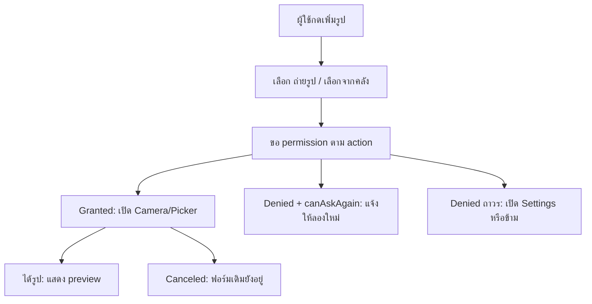

# Event Photo Camera

แอป Expo สำหรับ Lab 9: Camera, Image Picker และ Permissions

## Features

- ขอ permission เฉพาะตอนผู้ใช้กดใช้ฟีเจอร์
- ถ่ายรูปด้วย `expo-camera`
- เลือกรูปจากเครื่องด้วย `expo-image-picker`
- แสดง preview พร้อม Replace และ Remove
- รองรับ denied, denied ถาวร และ canceled path
- ฟิลเตอร์ 3 แบบ: ปรกติ, ขาวดำ, สดใส
- จำลอง upload และอธิบายการ validate รูป

## Install

```bash
npm install
npx expo install expo-camera expo-image-picker
```

## Run

```bash
npm run start
```

## Permission State Diagram



## File Validation

Client:

- ตรวจว่า MIME type ขึ้นต้นด้วย `image/`
- แจ้งเตือนเมื่อไฟล์ใหญ่กว่า 5 MB
- เก็บเฉพาะ draft local URI ก่อน submit

Server:

- ตรวจ MIME type ซ้ำจาก content จริง
- จำกัดขนาดไฟล์
- สแกน/แปลงไฟล์ก่อนเก็บ
- สร้าง URL ถาวรหลัง upload สำเร็จ

## Exit Ticket

1. `canAskAgain` ทำให้ UX เปลี่ยนจากปุ่มลองขอ permission อีกครั้ง เป็นปุ่มเปิด Settings เมื่อระบบถามซ้ำไม่ได้แล้ว
2. Backend ต้อง validate รูปซ้ำ เพราะ client ปลอม MIME type, extension หรือขนาดไฟล์ได้
3. ก่อน submit form ควรเก็บเป็น draft local URI ใน state ของฟอร์ม และค่อย upload เมื่อผู้ใช้กดยืนยัน
